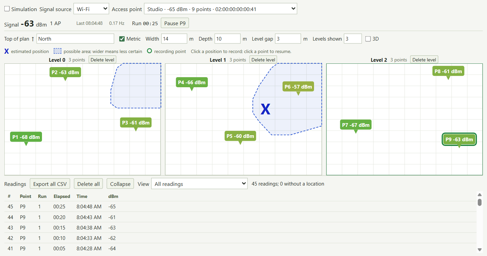
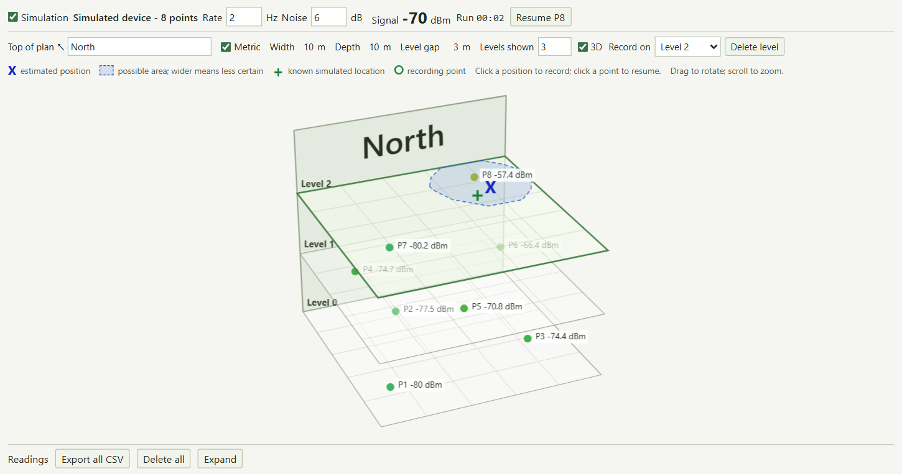

# Wireless Device Locator

Locate a Bluetooth Low Energy device or a Wi-Fi access point. Select the device, then click the receiver's position on the floor plan at each stop. Pause before you move. After readings from two distinct spots, a blue X marks the estimated location and a dashed outline shows where to search.

On Windows, run [Wireless Device Locator.cmd](<Wireless Device Locator.cmd>) with Python 3.10 or newer on PATH.

